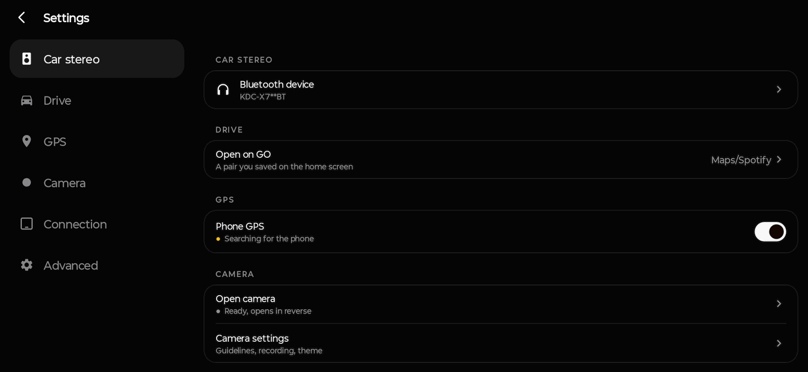
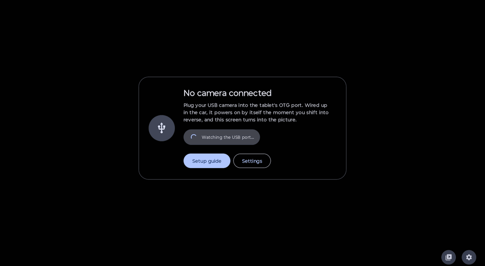
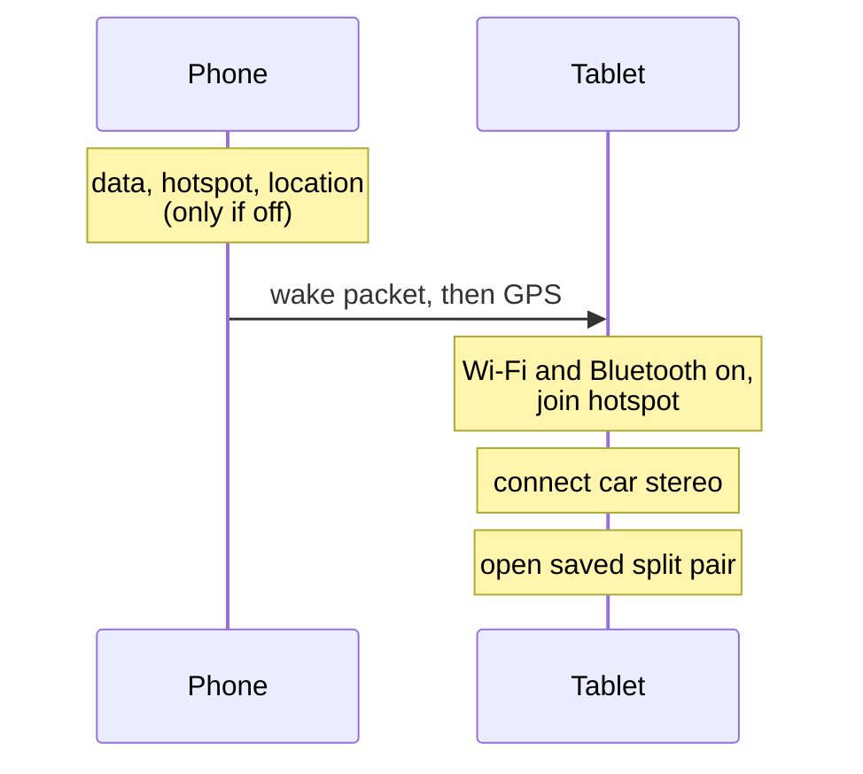

<div align="center">


# CarApp

**One tap on the phone sets up the car dash on the tablet.**

[](https://github.com/nathanrodrigues2111/lazycar/releases/latest)


[](LICENSE)

<a href="https://github.com/nathanrodrigues2111/lazycar/releases/latest"></a>

</div>

<br>

CarApp turns an Android phone and an Android tablet into a car dash. Press **GO** on the phone and the tablet wakes, joins the phone hotspot, connects the car stereo, takes the phone GPS and opens your Maps and music pair. Press **Shut down** and both devices go back to how they were.

The same APK goes on both devices. The role comes from the device model (Lenovo Tab Plus TB351FU is the tablet, anything else is the phone) and can be overridden in Settings.

## Screenshots


<p align="center">
  
</p>

<table>
  <tr>
    <td width="50%"></td>
    <td width="50%"></td>
  </tr>
  <tr>
    <td align="center"><sub>Tablet Settings, with Drive &gt; Open on GO</sub></td>
    <td align="center"><sub>Rearview, waiting for the USB camera</sub></td>
  </tr>
</table>

## Highlights

<table>
  <tr>
    <td width="50%" valign="top"><h3>👆 One press</h3>GO on the phone, in the app or as a home screen widget. Press again to Shut down.</td>
    <td width="50%" valign="top"><h3>📡 Hands off tablet</h3>The tablet wakes on the phone's packet and sets itself up. No taps on the dash.</td>
  </tr>
  <tr>
    <td width="50%" valign="top"><h3>🧭 Phone GPS</h3>The phone sends its GPS to the tablet, which uses it as a mock location for Maps.</td>
    <td width="50%" valign="top"><h3>🔊 Car stereo</h3>The tablet turns on Bluetooth and connects the stereo you picked.</td>
  </tr>
  <tr>
    <td width="50%" valign="top"><h3>🗺️ Your split pair</h3>Opens the Maps and music pair you saved in the Lenovo launcher, straight away.</td>
    <td width="50%" valign="top"><h3>📷 Rearview</h3>A UVC USB webcam on a reverse lamp relay opens CarApp's camera view when you reverse.</td>
  </tr>
</table>

Every step checks first and skips what is already right. Shut down only undoes what GO changed.

## How GO works



| | GO | Shut down |
| --- | --- | --- |
| **Phone** | Turns on data, hotspot and location only if off, using standard Android prompts | Turns off only what GO turned on |
| **Phone** | Wakes the tablet, starts sending GPS | Stops GPS |
| **Tablet** | Wi-Fi and Bluetooth on, joins the hotspot, connects the stereo | Disconnects the stereo, restores Wi-Fi and Bluetooth to how they were |
| **Tablet** | Opens the saved pair directly, without showing the CarApp screen | Closes what GO opened, screen off |

## Setup

1. Install the APK from [Releases](https://github.com/nathanrodrigues2111/lazycar/releases/latest) on both devices.
2. Open CarApp on each device and grant the one-time permissions it asks for.
3. **Tablet:** enable the CarApp helper once in Settings > Accessibility. It is what lets GO run without touching the tablet.
4. **Tablet:** choose CarApp as the mock location app in Developer options.
5. **Tablet:** in the Lenovo launcher, save your split pair (for example Maps and a music app) on the first home page. In CarApp Settings > Drive, set **Open on GO** to that pair.
6. **Tablet:** pick your car stereo in Settings.
7. **Phone:** add the GO widget for one-tap from the home screen.

## Rear camera

The app does not detect reverse gear. A relay driven by the reverse lamp powers a UVC USB webcam, so Android launches CarApp on `USB_DEVICE_ATTACHED` when you reverse. In the tablet USB prompt choose "Always open CarApp".

<details>
<summary><b>Wiring and parts</b></summary>
<br>

Parts: UVC webcam, USB 2.0 extension (5 m passive max), 12 V relay or relay module, USB-C OTG adapter, add-a-fuse tap.

```
 Reverse lamp +12V ──────────┐
 Reverse lamp GND ────────┐  │   (coil)
                       ┌──┴──┴──┐
                       │ RELAY  │
                       └──┬───┬─┘
 USB extension red (+5V) ─┘   └─ USB extension red (+5V) continues
   D+, D-, GND pass through uncut

 TABLET ──[USB-C OTG]──[USB extension, +5V via relay]──[WEBCAM]
```

- Cut only the red +5 V wire and route it through the relay's normally open contacts.
- A bare relay needs a 1N4007 across the coil. Modules have it built in.
- Use a Swipe lockscreen on the tablet. Showing over the lockscreen does not work with PIN or pattern.
- Most tablets cannot charge while hosting USB. Use a powered USB-C hub if yours supports host plus charge.

</details>

## Privacy

CarApp makes no internet requests and collects no data. GPS and settings travel only between the phone and the tablet over the phone hotspot.

<details>
<summary><b>Permissions and why</b></summary>
<br>

| Permission | Why |
| --- | --- |
| Location (fine, coarse) | Phone GPS source, and Android requires it for hotspot and Wi-Fi |
| Mock location app (Developer options) | Tablet replays the phone GPS to Maps |
| Bluetooth connect | Tablet connects the car stereo |
| Wi-Fi state, Wi-Fi multicast | Join the hotspot, receive GPS packets |
| Network state, internet | Local socket between phone and tablet (no internet traffic) |
| Accessibility (tablet, CarApp helper) | Wake on the phone packet, switch Wi-Fi and Bluetooth, open the saved pair |
| Camera, microphone | Rearview USB webcam |
| Notifications, foreground service | Keep GPS running, show its status |
| Boot completed | Restart GPS on boot |
| Ignore battery optimisation | Keep the tablet receiver alive |

</details>

<details>
<summary><b>Build from source</b></summary>
<br>

Needs JDK 17 and the Android SDK.

```
./gradlew assembleRelease
```

Release builds are signed with a private local keystore. Without it, use `./gradlew assembleDebug`.

</details>

<details>
<summary><b>Removed in 0.7.0</b></summary>
<br>

Music player and library, tablet audio streaming (sync, calibration, speaker handoff), CarApp-built split screen, and the phone accessibility service. The phone now uses standard Android prompts only.

</details>

## License

MIT. See [LICENSE](LICENSE).
