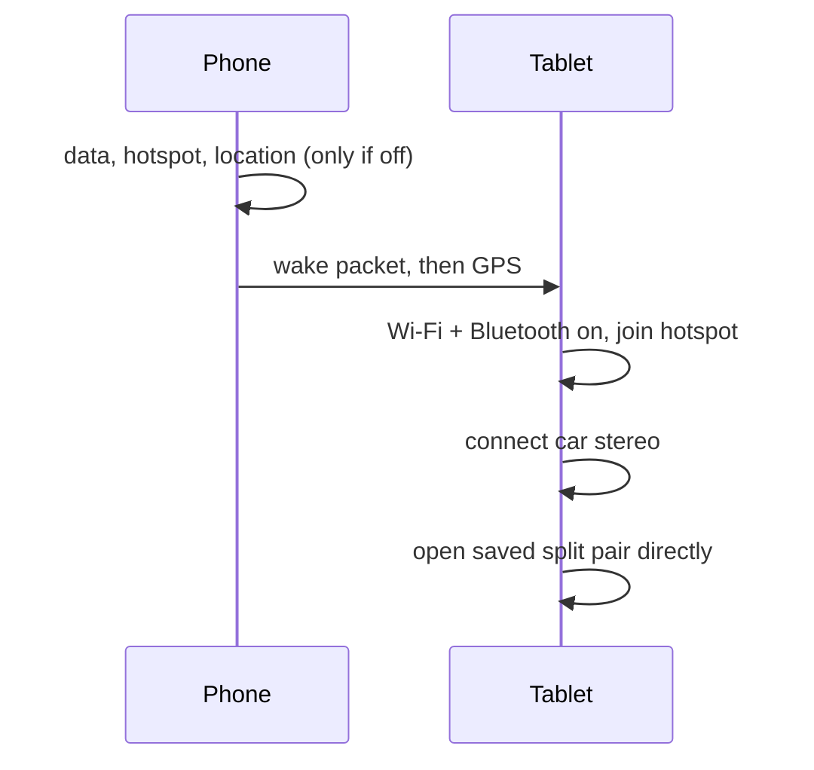

<div align="center">


# CarApp

**One tap on the phone sets up the car dash on the tablet.**

[](https://github.com/nathanrodrigues2111/lazycar/releases/latest)


  
</div>

CarApp runs on two devices: an Android phone and an Android tablet used as a car dash. The same APK goes on both. The role is detected from the device model (Lenovo Tab Plus TB351FU is the tablet, anything else is the phone) and can be overridden in Settings. The phone is locked to portrait.

## What it does

| Phone | Tablet |
| --- | --- |
| GO and Shut down, in the app and as a widget | GO runs by itself when the phone calls |
| Turns on only what is off: mobile data, hotspot, precise location (standard Android prompts) | Turns on Wi-Fi and Bluetooth, joins the phone hotspot |
| Wakes the tablet | Connects the car stereo you chose |
| Sends GPS to the tablet | Opens the app pair you saved in the Lenovo launcher |
| | Uses the phone GPS as a mock location |
| | Shows a rearview USB camera |



## Setup

1. Install the APK from [Releases](https://github.com/nathanrodrigues2111/lazycar/releases/latest) on both devices.
2. Open CarApp on each device and grant the one-time permissions it asks for.
3. Tablet: enable the CarApp helper once in Settings > Accessibility. It is what lets GO run without touching the tablet.
4. Tablet: choose CarApp as the mock location app in Developer options.
5. Tablet: in the Lenovo launcher, save your split pair (for example Maps and a music app) and keep it on the first home page. In CarApp Settings, Drive, set "Open on GO" to that pair.
6. Tablet: pick your car stereo in Settings.
7. Phone: add the GO widget if you want one-tap from the home screen.

## How GO and Shut down work

Every step checks first and skips what is already right. The button toggles between GO and Shut down.

| GO | Shut down |
| --- | --- |
| Phone: turns on data, hotspot, location only if off, using standard Android prompts | Phone: turns off only what GO turned on |
| Phone: wakes the tablet, starts sending GPS | Phone: stops GPS |
| Tablet: Wi-Fi and Bluetooth on, joins the hotspot, connects the stereo | Tablet: disconnects the stereo, restores Wi-Fi and Bluetooth to how they were |
| Tablet: opens the saved pair directly, without showing the CarApp screen (fix in progress) | Tablet: closes what GO opened, screen off |

Shut down never touches anything GO did not change.

## Rear camera

The app does not detect reverse gear. A relay driven by the reverse lamp powers a UVC USB webcam, so Android launches CarApp on `USB_DEVICE_ATTACHED` when you reverse. In the tablet USB prompt choose "Always open CarApp".

Parts: UVC webcam, USB 2.0 extension (5 m passive max), 12 V relay or relay module, USB-C OTG adapter, add-a-fuse tap.

```
 Reverse lamp +12V ──────────┐
 Reverse lamp GND ────────┐  │   (coil)
                       ┌──┴──┴──┐
                       │ RELAY  │
                       └──┬───┬─┘
 USB extension red (+5V) ─┘   └─ USB extension red (+5V) continues
   D+, D-, GND pass through uncut

 TABLET ──[USB-C OTG]──[USB extension, +5V via relay]──[WEBCAM]
```

- Cut only the red +5 V wire and route it through the relay's normally open contacts.
- A bare relay needs a 1N4007 across the coil. Modules have it built in.
- Use a Swipe lockscreen on the tablet. Showing over the lockscreen does not work with PIN or pattern.
- Most tablets cannot charge while hosting USB. Use a powered USB-C hub if yours supports host plus charge.

## Permissions

| Permission | Why |
| --- | --- |
| Location (fine, coarse) | Phone GPS source, and Android requires it for hotspot and Wi-Fi |
| Mock location app (Developer options) | Tablet replays the phone GPS to Maps |
| Bluetooth connect | Tablet connects the car stereo |
| Wi-Fi state, Wi-Fi multicast | Join the hotspot, receive GPS packets |
| Network state, internet | Local socket between phone and tablet (no internet traffic) |
| Accessibility (tablet, CarApp helper) | Wake on the phone packet, switch Wi-Fi and Bluetooth, open the saved pair |
| Camera, microphone | Rearview USB webcam |
| Notifications, foreground service | Keep GPS running, show its status |
| Boot completed | Restart GPS on boot |
| Ignore battery optimisation | Keep the tablet receiver alive |

## Privacy

CarApp makes no internet requests and collects no data. GPS and settings travel only between the phone and tablet over the phone hotspot.

## Build from source

Needs JDK 17 and the Android SDK.

```
./gradlew assembleRelease
```

Release builds are signed with a private local keystore. Without it, use `./gradlew assembleDebug`.

## Removed in 0.7.0

Music player and library, tablet audio streaming (sync, calibration, speaker handoff), CarApp-built split screen, and the phone accessibility service. The phone now uses standard Android prompts only.

## License

MIT. See [LICENSE](LICENSE).
